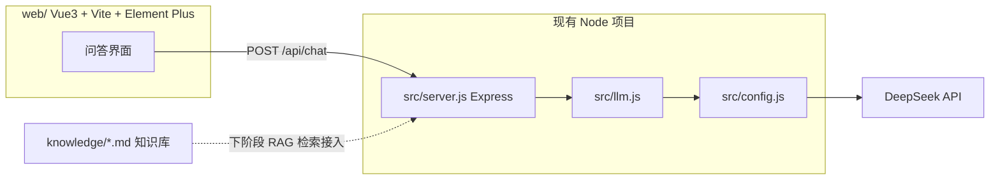

## 产品概述

为下阶段 RAG 学习搭建前期基础设施，交付三样东西：一份 Agent 开发主题的多文档知识库（数据源）、一个基于 Express 的 HTTP 接口层（问答接口，返回结构预留检索片段字段）、一个 Vue 3 + Vite + Element Plus 的 RAG 问答演示前端。本次不实现 RAG 核心算法（切块、向量化、检索），先搭好"数据 + 接口 + 界面"三层骨架，后续 RAG 学习时平滑接入。

## 核心功能

- 知识库文件：Agent 开发主题的多篇 Markdown 文档，内容充实、结构清晰、含代码示例与 FAQ，为后续切块/检索提供高质量数据源
- HTTP 问答接口：POST /api/chat 接收问题并调用现有 llm.js 作答，返回结构预留 sources 检索片段字段，后续可替换为真实 RAG 检索
- 演示前端：左侧对话区（提问与回答）、右侧检索片段展示区（当前空数组显示占位）、底部输入区，开发环境通过 Vite 代理真连后端
- 扩展性：前端按组件拆分、接口返回结构预留 RAG 字段、后端路由预留检索接口位置，便于后期项目变大

## 技术栈

- 后端：Node.js（现有 ESM 项目）+ Express（新增依赖）
- 前端：Vue 3 + Vite + Element Plus
- 知识库：Markdown 多文档
- LLM 调用：复用现有 src/llm.js 与 src/config.js

## 实现方案

### 总体思路

沿用当前项目的分层方式，新增三个独立模块：`knowledge/`（数据层）、`src/server.js`（接口层）、`web/`（展示层）。三者通过 HTTP 接口解耦，知识库本次只做数据准备、不参与检索，接口层的 sources 字段预留给下阶段 RAG 检索结果。

### 1. 知识库设计（Agent 开发主题）

目录 `knowledge/`，拆成 11 篇文档，每篇围绕一个 Agent 开发核心主题，内容含概念、原理、代码示例、对比表格、最佳实践与常见坑，单篇数百行以保障后续切块后产生多个语义完整片段：

- 00-知识库索引.md：知识库说明、文档导航、RAG 学习建议
- 01-Agent基础概念.md：什么是 Agent、与 LLM 的区别、Agent 架构组成
- 02-ReAct循环与工具调用.md：推理-行动-观察循环、多轮决策、最大轮次
- 03-函数调用协议.md：tool schema、tool_calls、arguments JSON、结果回填
- 04-上下文与消息管理.md：system prompt、消息历史、token 窗口、截断策略
- 05-流式输出与错误处理.md：SSE 解析、超时重试、指数退避、错误分类
- 06-安全与沙箱.md：路径沙箱、SSRF 拦截、关键文件保护
- 07-可观测性与调试.md：trace 日志、token 统计、事件回放
- 08-RAG与知识增强.md：RAG 概念、chunking、embedding、检索增强（为下阶段铺垫）
- 09-评测与测试.md：离线测试、mock 策略、断言思路
- 10-常见问题FAQ.md：高频问题与排错清单

### 2. HTTP 接口层设计

新增 `src/server.js`，使用 Express 暴露接口，安装 `express` 依赖。接口契约：

- `GET /api/health`：返回 `{ ok: true }` 健康检查
- `POST /api/chat`：请求 `{ question: string }`，响应 `{ answer: string, sources: [] }`，其中 sources 为预留字段（下阶段填检索片段）

实现要点：调用当前 llm.js 的 chat（当前返回裸 message，需取 `.content`），用 try/catch 捕获异常返回 500 与可读错误信息，不向客户端泄露 apiKey 与堆栈；预留 CORS 与静态托管逻辑，便于生产模式托管 web 构建产物。

### 3. 前端设计

新增 `web/` 目录，Vue 3 + Vite + Element Plus。组件拆分：App.vue（整体布局）、ChatPanel.vue（对话列表）、QuestionInput.vue（输入框与发送）、SourcesPanel.vue（检索片段展示区）、api/chat.js（接口封装）。Vite 配置 `/api` 代理到后端 3000 端口，避免开发期跨域。

### 架构图



## 目录结构

```
agent-study-1/
├── knowledge/                    # [NEW] 知识库目录
│   ├── 00-知识库索引.md
│   ├── 01-Agent基础概念.md
│   ├── 02-ReAct循环与工具调用.md
│   ├── 03-函数调用协议.md
│   ├── 04-上下文与消息管理.md
│   ├── 05-流式输出与错误处理.md
│   ├── 06-安全与沙箱.md
│   ├── 07-可观测性与调试.md
│   ├── 08-RAG与知识增强.md
│   ├── 09-评测与测试.md
│   └── 10-常见问题FAQ.md
├── src/
│   └── server.js                 # [NEW] Express 服务：/api/health、/api/chat，预留 sources
├── web/                          # [NEW] Vue 前端项目
│   ├── package.json
│   ├── vite.config.js            # 含 /api 代理配置
│   ├── index.html
│   └── src/
│       ├── main.js
│       ├── App.vue
│       ├── api/chat.js           # 封装 POST /api/chat
│       └── components/
│           ├── ChatPanel.vue
│           ├── QuestionInput.vue
│           └── SourcesPanel.vue
└── package.json                  # [MODIFY] 新增 express 依赖与 server 脚本
```

## 关键接口契约

```js
// POST /api/chat 请求体
{ question: string }

// POST /api/chat 响应体（sources 为下阶段 RAG 检索片段预留）
{
  answer: string,
  sources: Array<{ file: string, content: string, score: number }>  // 当前阶段恒为 []
}
```

## 实施要点

- 教练模式：每步由 AI 提供完整源码与操作命令，用户手动创建文件、执行命令，AI 不代改代码
- 兼容性：server.js 对接当前 llm.js 的返回结构（裸 message），后续 llm.js 重构为返回 `{ message, usage, model }` 时同步微调取值方式
- 安全：接口不返回 apiKey、不打印堆栈到响应、错误信息对人类可读

## 设计风格

采用现代科技感的简洁问答工具风格，以清晰的信息层级支撑"提问 → 看回答 → 看检索依据"的 RAG 演示流程。整体使用 Element Plus 组件体系，蓝紫色主色调营造智能助手氛围，卡片化布局、圆角与轻阴影提升质感。

## 页面结构（单页 RAG 问答演示界面）

- 顶部导航栏：左侧产品标题与知识库名称标识，右侧环境状态标签（接口连通状态）
- 主内容区（左右分栏）：左侧为对话区，按时间流展示用户问题气泡与 AI 回答卡片；右侧为检索片段区，卡片化展示 sources 列表（文件来源、内容摘要、相关度），当前为空数组时显示占位提示"暂无检索片段，接入 RAG 后展示"
- 底部输入区：多行输入框、发送按钮、回车发送提示，输入框聚焦态高亮

## 交互设计

- 发送后问题即时上屏，显示加载态，回答到达后渲染
- 检索片段区与回答区联动预留：后续 sources 非空时点击片段可高亮对应依据
- 响应式布局：窄屏时右侧片段区折叠为抽屉